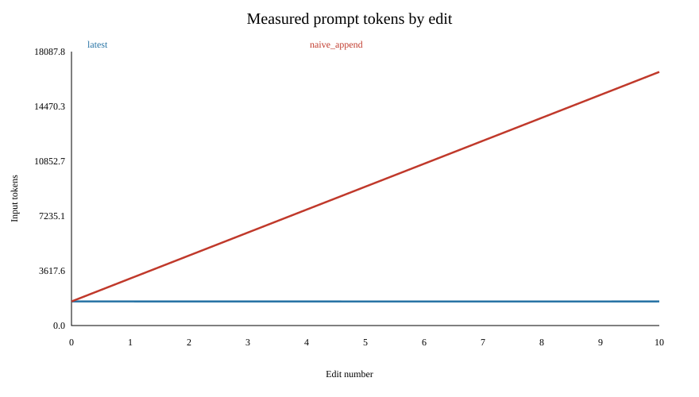
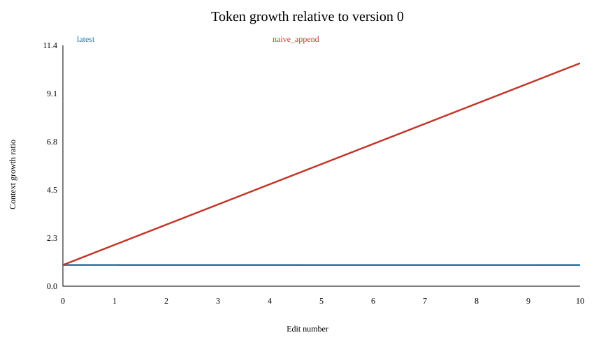
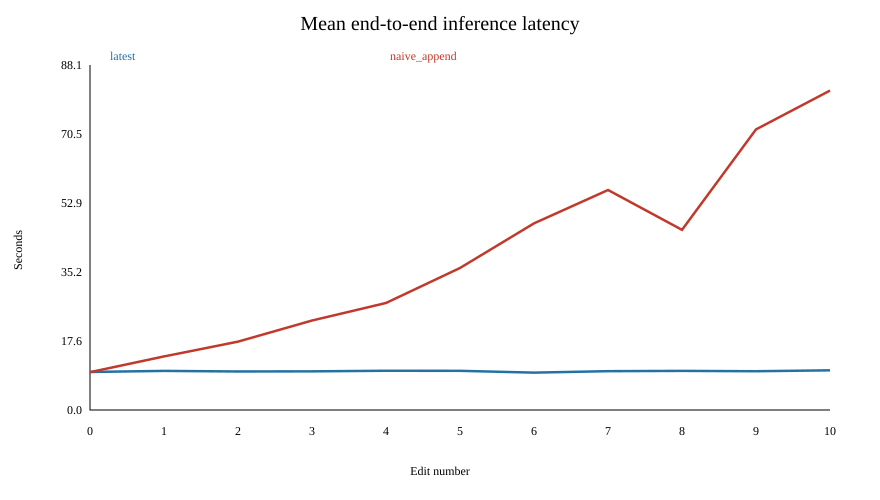
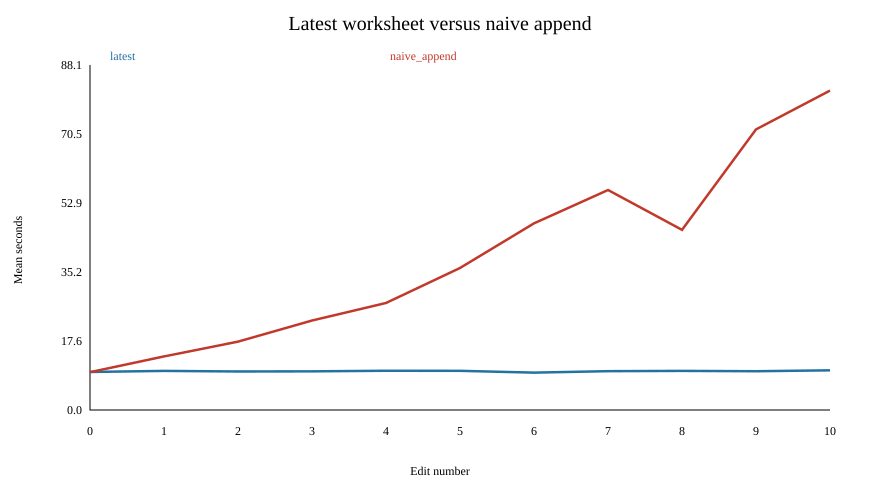

# Math worksheet context-appending benchmark

## Execution status
Actual GPU measurements: 66 requests. Inspect run_metadata.json for completion status.

The real CPU tokenizer measurements in context_counts.csv are prompt-size measurements. Latency figures explicitly mark missing data. No latency, output length, correctness, TTFT, prefill or GPU-memory values are fabricated.

## Application and data
The application loads real [GSM8K](https://huggingface.co/datasets/openai/gsm8k) main/test questions at immutable revision `740312add88f781978c0658806c59bc2815b9866`. It uses the first 20 test problems with stable row-based IDs. GSM8K supplies short numerical reasoning problems and reference final answers. The target `GSM8K-test-0000` stays unchanged. Solutions are never included in prompts; edited distractor labels are invalidated. This is a controlled workload, not a representative accuracy evaluation.

## Model and methodology
The inference configuration uses vLLM and [Qwen/Qwen2.5-1.5B-Instruct](https://huggingface.co/Qwen/Qwen2.5-1.5B-Instruct), revision `989aa7980e4cf806f80c7fef2b1adb7bc71aa306`, in FP16. The context budget is 32768 including an output reservation of 256 tokens. Every prompt is checked before inference; none is truncated. Local auditing uses the real Qwen tokenizer and validates the system/user rendering against its official chat template.

Eleven worksheet versions comprise the original and ten sequential edits. Each changes exactly one numerical span in a non-target problem. Latest-only includes one worksheet; naive append includes every version through the current edit. Both share system instructions, newest-version question and target. Model responses are not appended.

The remote runner first checks a small real inference, then warms both shortest and longest prompts. The planned experiment has three repetitions per condition (66 serial requests), seeded randomized edit and paired condition order, greedy generation, seed 42, top_p=1, fixed output cap 256. Prefix caching is explicitly disabled. Chunked prefill is requested off, but vLLM V1 can override this; inspect effective_engine_settings in run_metadata.json for the actual setting. Eager execution avoids graph compilation, with identical configuration across conditions.

Latency brackets synchronous vLLM generation with CUDA synchronization. It includes prefill and decoding, excluding model loading, tokenizer work, warm-up, network transport and file writes. It is end-to-end engine request latency, not browser-to-server latency. TTFT uses engine metrics only if populated; isolated prefill remains null. GPU memory is a device-wide nvidia-smi snapshot after each request, including reserved KV cache, not peak per-request usage.

## Actual token measurements
| Edit | Latest tokens | Append tokens | Extra tokens | Append/latest |
| --- | ---: | ---: | ---: | ---: |
| 0 | 1591 | 1591 | 0 | 1.000 |
| 1 | 1591 | 3108 | 1517 | 1.953 |
| 2 | 1590 | 4624 | 3034 | 2.908 |
| 3 | 1590 | 6140 | 4550 | 3.862 |
| 4 | 1590 | 7656 | 6066 | 4.815 |
| 5 | 1589 | 9171 | 7582 | 5.772 |
| 6 | 1589 | 10686 | 9097 | 6.725 |
| 7 | 1589 | 12201 | 10612 | 7.678 |
| 8 | 1589 | 13716 | 12127 | 8.632 |
| 9 | 1589 | 15231 | 13642 | 9.585 |
| 10 | 1591 | 16748 | 15157 | 10.527 |

At edit 10, naive append has **16,748** input tokens versus **1,591**, a **10.527x** ratio and **15,157** extra tokens. Across one request for each version, totals are 17,488 latest tokens and 100,872 append tokens: 83,384 extra, or 5.768x. Three repetitions would multiply these totals by three.

Full-worksheet duplication gives approximately linear context growth with edit number, and approximately quadratic cumulative input tokens across updates when worksheet size is stable. This is an algorithmic interpretation of token counts, not a timing measurement.

## Inference comparison

latest: 33 requests; mean latency 9.9005s; correctness 0/33.

naive_append: 33 requests; mean latency 39.1214s; correctness 6/33.

Per-edit latency differences and ratios are in comparison.csv. Check paired repetitions and completion status before interpreting partial runs.

## Completed T4 experiment

One standard Tesla T4 session was allocated successfully with the account showing a zero compute-unit balance. No purchase or billing change was made. All 66 requests completed: three repetitions, both conditions, original plus all ten edits. The real dataset and model revisions were reused.

Effective engine settings: {"attention_backend": "FLEX_ATTENTION", "enable_chunked_prefill": true, "enable_prefix_caching": false}. The KV cache was capped at 2,048 blocks of 16 tokens (32,768 tokens) to bound FlexAttention mask memory. The unbounded-cache warm-up ran out of memory; XFormers lacked T4 paged-attention kernels. Those startup attempts produced no benchmark rows; their logs are preserved.

The first smoke check rejected a correct unmarked equation. The smoke-only validator now accepts the exact equation 2 + 2 = 4 in addition to the final-answer marker. Benchmark scoring remains strict and unchanged.

| Edit | Latest mean ± SD (s) | Append mean ± SD (s) | Paired difference (s) | Ratio of means | Mean output tokens, latest / append |
| --- | ---: | ---: | ---: | ---: | ---: |
| 0 | 9.713 ± 0.411 | 9.664 ± 0.206 | -0.048 | 0.995 | 226.0 / 226.0 |
| 1 | 9.985 ± 0.791 | 13.684 ± 1.371 | 3.699 | 1.370 | 226.0 / 196.7 |
| 2 | 9.837 ± 0.548 | 17.462 ± 1.280 | 7.625 | 1.775 | 226.0 / 183.0 |
| 3 | 9.871 ± 0.500 | 22.852 ± 1.178 | 12.981 | 2.315 | 226.0 / 183.0 |
| 4 | 10.024 ± 0.415 | 27.332 ± 1.620 | 17.308 | 2.727 | 226.0 / 171.0 |
| 5 | 10.002 ± 0.183 | 36.268 ± 2.525 | 26.266 | 3.626 | 226.0 / 189.7 |
| 6 | 9.543 ± 0.267 | 47.666 ± 3.864 | 38.123 | 4.995 | 226.0 / 224.0 |
| 7 | 9.916 ± 0.284 | 56.176 ± 2.286 | 46.259 | 5.665 | 226.0 / 240.0 |
| 8 | 9.987 ± 0.476 | 46.003 ± 2.800 | 36.017 | 4.606 | 226.0 / 132.0 |
| 9 | 9.899 ± 0.053 | 71.656 ± 3.169 | 61.756 | 7.238 | 226.0 / 224.0 |
| 10 | 10.130 ± 0.677 | 81.573 ± 2.304 | 71.443 | 8.053 | 236.0 / 225.0 |

SD is sample standard deviation across three repetitions; ratios divide condition means. Paired differences match repetition and edit. No outliers are removed.

latest: total measured input tokens 52,464; total engine latency 326.718s; 1 output-cap terminations; 0/33 strict-marker correct answers.

naive_append: total measured input tokens 302,616; total engine latency 1291.008s; 0 output-cap terminations; 6/33 strict-marker correct answers.

Across all 33 requests per condition, append adds 964.290s of measured engine time (3.951x total latency) and 250,152 input tokens. These totals exclude all startup attempts and warm-up.

latest parsed final answers: {'9': 32, 'unparsed': 1}. The correct reference is 18 dollars.

naive_append parsed final answers: {'18': 6, '9': 14, '26': 3, '29.30': 3, '224': 3, '29.23': 3, 'unparsed': 1}. The correct reference is 18 dollars.

A checked latest-only response returns 9, the number of eggs sold, instead of multiplying by the price of 2 dollars to reach 18. Thus low correctness is not solely a formatting artifact. This workload benchmarks latency but does not demonstrate a reliable math tutor.

Latency is not monotonic: append falls from 56.176s at edit 7 to 46.003s at edit 8 while input tokens increase. Its mean output falls from 240 to 132 tokens. This is concrete evidence of decoding-length confounding.

3 of the 22 condition/version groups produced differing output text across greedy repetitions. Fixed seeds and temperature zero did not guarantee bit-identical results in this runtime.

At edit 10, append latency is 81.573s versus 10.130s: 71.443s extra and 8.053x the latest-only mean. This measures total engine inference, not isolated prefill. Output lengths differ; the observed latency difference cannot be attributed entirely to input context growth. Model accuracy and formatting failures must be read from the raw outputs.

TTFT and prefill latency are unreported when unsupported. GPU memory snapshots include retained allocations. The results describe this T4/FlexAttention configuration, not a universal vLLM latency law. Eager mode does not eliminate internal attention-kernel compilation, which may cause first-repetition outliers after the two warm-up requests. PatchKV was not evaluated.

## Limitations and confounders
A small fixed worksheet and single unchanged target do not establish general math accuracy. Edits may make distractors inconsistent, and only the target is scored. Greedy decoding is not guaranteed identical across hardware or software versions. Variable output lengths and output-cap termination affect latency; examine output tokens and finish reasons. Strict final-marker scoring can reject another correct answer format. GPU clocks, shared load, thermal state, warm-up, reserved cache and request order affect timings. Three repetitions provide descriptive comparisons, not strong statistical inference. Prefix caching is deliberately disabled and is not the default in every deployed service. Device memory snapshots do not measure peak request allocations. The remote dependency versions are saved in environment_remote.txt. FlexAttention can compile kernels for new shapes even in eager mode; warm-up of only short and longest prompts may leave first-encounter shape overhead in measurements.

## Future PatchKV evaluation
Stable IDs and recorded edit spans provide a future PatchKV integration point. A follow-up must implement PatchKV, verify answer equivalence, and compare update cost and cache reuse against both full recomputation and automatic prefix caching under identical hardware and workloads. PatchKV is not implemented or evaluated here; no PatchKV speedup is claimed.

## Sources
- [GSM8K dataset card](https://huggingface.co/datasets/openai/gsm8k)
- [Qwen configuration](https://huggingface.co/Qwen/Qwen2.5-1.5B-Instruct/blob/main/config.json)
- [vLLM engine arguments](https://docs.vllm.ai/en/v0.11.0/configuration/engine_args/)
- [Google Colab CLI](https://github.com/googlecolab/google-colab-cli)
