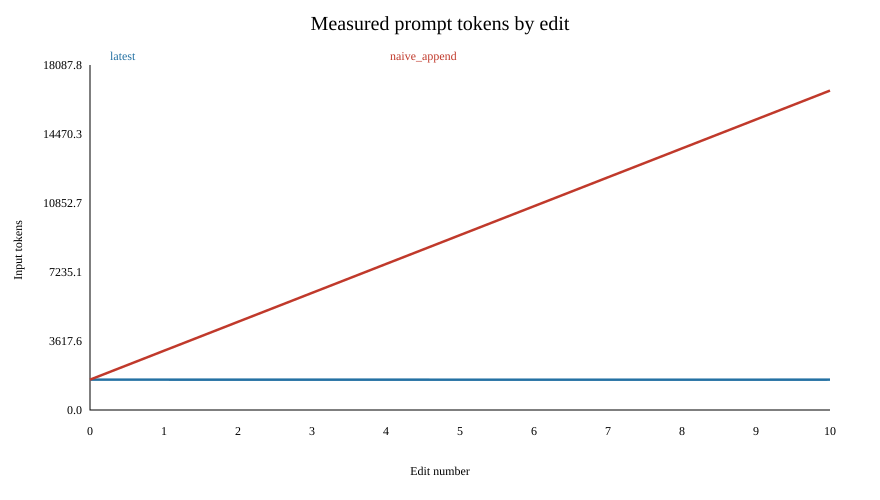
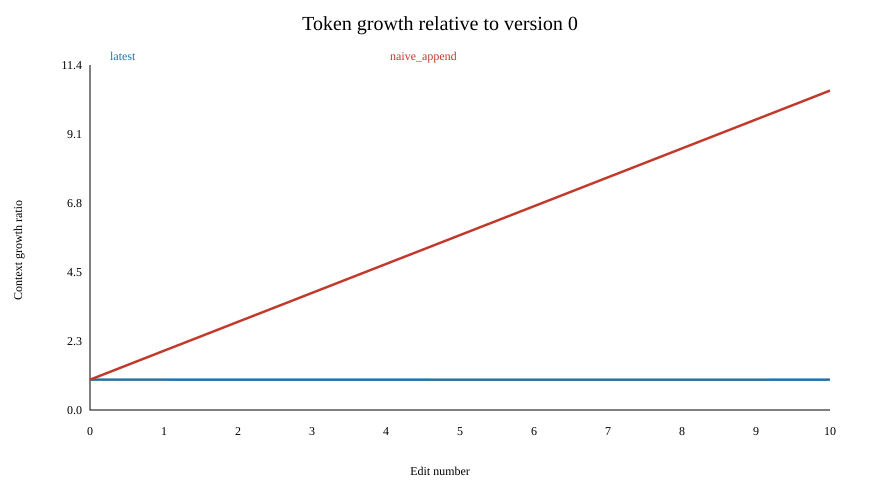
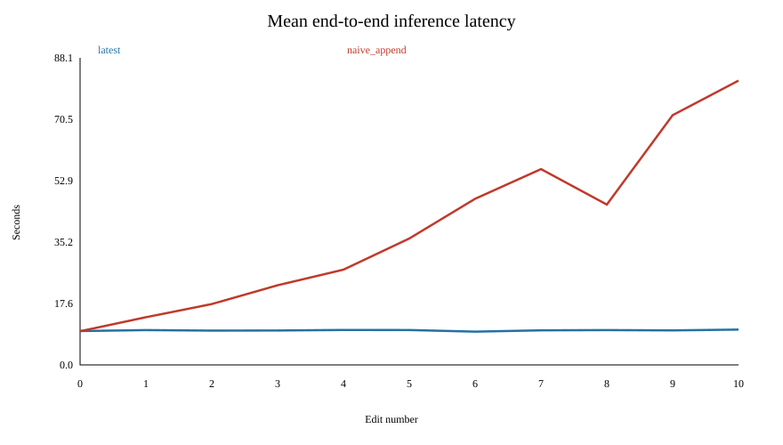
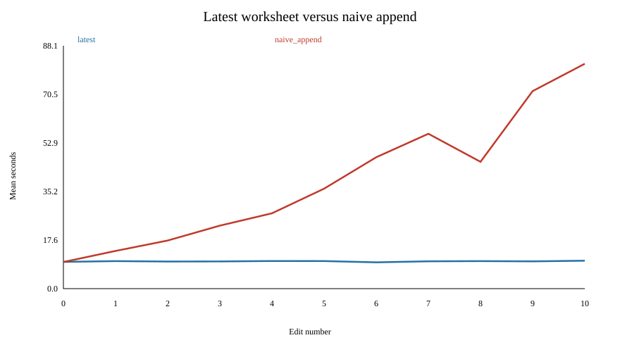

# Math worksheet context-appending benchmark

## Execution status
Actual GPU measurements: 66 requests. Inspect run_metadata.json for completion status.

The real CPU tokenizer measurements in context_counts.csv are prompt-size measurements. Latency figures explicitly mark missing data. No latency, output length, correctness, TTFT, prefill or GPU-memory values are fabricated.

## Application and data
The application loads real [GSM8K](https://huggingface.co/datasets/openai/gsm8k) main/test questions at immutable revision `740312add88f781978c0658806c59bc2815b9866`. It uses the first 20 test problems with stable row-based IDs. GSM8K supplies short numerical reasoning problems and reference final answers. The target `GSM8K-test-0000` stays unchanged. Solutions are never included in prompts; edited distractor labels are invalidated. This is a controlled workload, not a representative accuracy evaluation.

## Model and methodology
The planned inference uses vLLM and [Qwen/Qwen2.5-1.5B-Instruct](https://huggingface.co/Qwen/Qwen2.5-1.5B-Instruct), revision `989aa7980e4cf806f80c7fef2b1adb7bc71aa306`, in FP16. The context budget is 32768 including an output reservation of 256 tokens. Every prompt is checked before inference; none is truncated. Local auditing uses the real Qwen tokenizer and validates the system/user rendering against its official chat template.

Eleven worksheet versions comprise the original and ten sequential edits. Each changes exactly one numerical span in a non-target problem. Latest-only includes one worksheet; naive append includes every version through the current edit. Both share system instructions, newest-version question and target. Model responses are not appended.

The remote runner first checks a small real inference, then warms both shortest and longest prompts. The planned experiment has three repetitions per condition (66 serial requests), seeded randomized edit and paired condition order, greedy generation, seed 42, top_p=1, fixed output cap 256. Prefix caching and chunked prefill are explicitly disabled. Eager execution avoids graph compilation, with identical configuration across conditions.

Latency brackets synchronous vLLM generation with CUDA synchronization. It includes prefill and decoding, excluding model loading, tokenizer work, warm-up, network transport and file writes. It is end-to-end engine request latency, not browser-to-server latency. TTFT uses engine metrics only if populated; isolated prefill remains null. GPU memory is a device-wide nvidia-smi snapshot after each request, including reserved KV cache, not peak per-request usage.

## Actual token measurements
| Edit | Latest tokens | Append tokens | Extra tokens | Append/latest |
| --- | ---: | ---: | ---: | ---: |
| 0 | 1591 | 1591 | 0 | 1.000 |
| 1 | 1591 | 3108 | 1517 | 1.953 |
| 2 | 1590 | 4624 | 3034 | 2.908 |
| 3 | 1590 | 6140 | 4550 | 3.862 |
| 4 | 1590 | 7656 | 6066 | 4.815 |
| 5 | 1589 | 9171 | 7582 | 5.772 |
| 6 | 1589 | 10686 | 9097 | 6.725 |
| 7 | 1589 | 12201 | 10612 | 7.678 |
| 8 | 1589 | 13716 | 12127 | 8.632 |
| 9 | 1589 | 15231 | 13642 | 9.585 |
| 10 | 1591 | 16748 | 15157 | 10.527 |

At edit 10, naive append has **16,748** input tokens versus **1,591**, a **10.527x** ratio and **15,157** extra tokens. Across one request for each version, totals are 17,488 latest tokens and 100,872 append tokens: 83,384 extra, or 5.768x. Three repetitions would multiply these totals by three.

Full-worksheet duplication gives approximately linear context growth with edit number, and approximately quadratic cumulative input tokens across updates when worksheet size is stable. This is an algorithmic interpretation of token counts, not a timing measurement.

## Inference comparison

latest: 33 requests; mean latency 9.9005s; correctness 0/33.

naive_append: 33 requests; mean latency 39.1214s; correctness 6/33.

Per-edit latency differences and ratios are in comparison.csv. Check paired repetitions and completion status before interpreting partial runs.

## Limitations and confounders
A small fixed worksheet and single unchanged target do not establish general math accuracy. Edits may make distractors inconsistent, and only the target is scored. Greedy decoding is not guaranteed identical across hardware or software versions. Variable output lengths and output-cap termination affect latency; examine output tokens and finish reasons. Strict final-marker scoring can reject another correct answer format. GPU clocks, shared load, thermal state, warm-up, reserved cache and request order affect timings. Three repetitions provide descriptive comparisons, not strong statistical inference. Prefix caching is deliberately disabled and is not the default in every deployed service. Device memory snapshots do not measure peak request allocations. Save environment_remote.txt for the eventual remote run.

## Future PatchKV evaluation
Stable IDs and recorded edit spans provide a future PatchKV integration point. A follow-up must implement PatchKV, verify answer equivalence, and compare update cost and cache reuse against both full recomputation and automatic prefix caching under identical hardware and workloads. PatchKV is not implemented or evaluated here; no PatchKV speedup is claimed.

## Sources
- [GSM8K dataset card](https://huggingface.co/datasets/openai/gsm8k)
- [Qwen configuration](https://huggingface.co/Qwen/Qwen2.5-1.5B-Instruct/blob/main/config.json)
- [vLLM engine arguments](https://docs.vllm.ai/en/v0.11.0/configuration/engine_args/)
- [Google Colab CLI](https://github.com/googlecolab/google-colab-cli)
